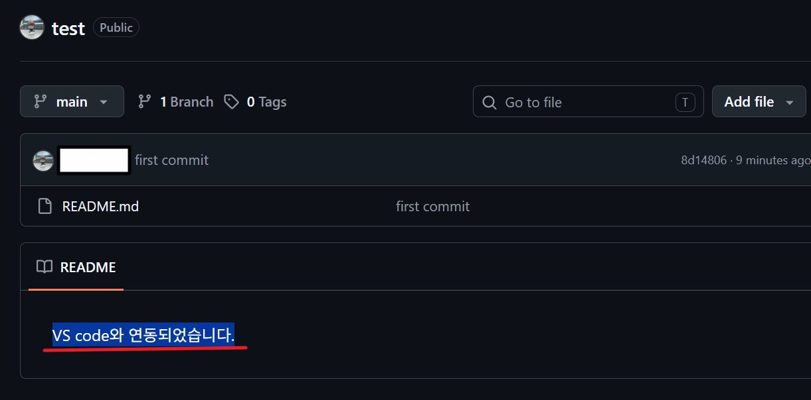

# 🐳 E1-1  내 컴퓨터에 개발자용 '작업실' 꾸미기 


---
        
## 1. 프로젝트 개요


**Codyssey 올인원 1기 입학연수 E1-1 미션입니다.**

Flask 기반 방명록 웹 애플리케이션을 Docker로 컨테이너화하고,  
포트 매핑 / 바인드 마운트 / 볼륨 영속성 등을 실습한 프로젝트입니다.

### 미션 목표
- `Dockerfile`을 작성하여 커스텀 이미지 빌드
- `포트 매핑`으로 컨테이너 2개 동시 실행
- `바인드 마운트`로 호스트 코드 변경 즉시 반영
- Docker `볼륨`으로 컨테이너 삭제 후에도 데이터 유지
- `Git` 설정 및 GitHub/VSCode 연동
    


---

## 2. 실행 환경

- OS: Windows 11 pro / Ubuntu 26.04.1 LTS
- Shell: PowerShell 5.1 / GNU bash, version 5.3.9
- Docker: 29.9.2
- Git: 2.56.0


---
## 3. 사전 준비 : Ubuntu 설치 
5-1, 5-2 실습을 수행하기 위해 Ubuntu를 설치합니다.  

### 📌 설치 이유
- Git Bash는 NTFS 파일시스템 기반 → `chmod` 권한 변경 불가
- Ubuntu (WSL3)는 ext4 파일시스템 → `chmod` 실습 가능

### 🔧 설치 방법


**PowerShell(관리자 권한)에서 다음 작업 진행**

1️⃣ Ubuntu 설치   
```PowerShell
# PowerShell에서 작업
$ wsl --install -d Ubuntu
다운로드 중: Ubuntu
설치 중: Ubuntu
배포가 설치되었습니다.
Ubuntu 시작하는 중...
Provisioning the new WSL instance Ubuntu
This might take a while...
Create a default Unix user account: redna
New password:
Retype new password:
passwd: password updated successfully

# 설치완료 후 자동으로 Ubuntu Bash Shell로 진입
# exit 입력 후 PowerShell로 돌아와 다음 단계 진행
redna@js:/mnt/c/WINDOWS/System32$ : exit
```


2️⃣ 설치 확인

```PowerShell
# PowerShell에서 작업
$ wsl -l -v
  NAME      STATE           VERSION
* Ubuntu    Running         2
```

3️⃣ Ubuntu 실행
```PowerShell
# PowerShell에서 작업
$ wsl -d Ubuntu
redna@js:/mnt/c/WINDOWS/System32$
```

⚠️ 문제 발생 시: Ubuntu 재설치  
Ubuntu를 완전히 제거하고 다시 설치하려면:

```PowerShell
# PowerShell에서 작업

# 1. Ubuntu 완전 제거 (데이터 포함)
$ wsl --unregister Ubuntu

# 2. 다시 설치
$ wsl --install -d Ubuntu

# 3. 설치 확인
$ wsl -l -v
```


___

## 4. 수행 체크리스트

- [x] 터미널 기본 조작 및 폴더 구성
- [x] 권한 변경 실습
- [x] Docker 설치/점검
- [x] hello-world 실행
- [x] Dockerfile 빌드/실행
- [x] 포트 매핑 접속(2회)
- [x] 바인드 마운트 반영
- [x] 볼륨 영속성
- [x] Git 설정 + VSCode GitHub 연동

___

## 5. 수행로그 


### 5-1 터미널 기본 조작 및 폴더 구성


```bash
# [PowerShell] Ubuntu 진입
$ wsl -d Ubuntu

# Ubuntu Bash Shell 진입 확인
redna@js:/mnt/c/WINDOWS/System32$

# Home 폴더로 이동
redna@js:/mnt/c/WINDOWS/System32$ cd ~
redna@js:~$

# 이 밑으로는 "redna@js:~$" 대신 "$" 로만 표기
```


```bash
# ── 터미널 조작 로그 기록 ────────────────────────────

# 1. 현재 위치 확인
$ pwd
/home/redna

# 2. 목록 확인 (숨김 파일 포함)
$ ls -al
total 32
drwxr-x--- 4 redna redna 4096 Nov  5 15:27 .
drwxr-xr-x 3 root  root  4096 Nov  5 15:25 ..
-rw------- 1 redna redna   50 Nov  5 16:24 .bash_history
-rw-r--r-- 1 redna redna  220 Nov  5 15:25 .bash_logout
-rw-r--r-- 1 redna redna 3771 Nov  5 15:25 .bashrc
drwxr-x--- 4 redna redna 4096 Nov  5 15:25 .cache
drwxr-x--- 3 redna redna 4096 Nov  5 15:25 .config
-rw-rw-r-- 1 redna redna    0 Nov  5 15:25 .motd_shown
-rw-r--r-- 1 redna redna  807 Nov  5 15:25 .profile

# 3. 폴더 생성
$ mkdir practice

# 4. 폴더 이동
$ cd practice
$ pwd
/home/redna/practice

# 5. 빈 파일 생성
$ touch file_A.txt
$ ls
file_A.txt

# 6. 파일에 내용 쓰기 (touch로 만든 파일에 덮어쓰기)
$ echo "파일 A입니다." > file_A.txt

# 7. 파일 내용 확인
$ cat file_A.txt
파일 A입니다.

# 8. 파일 복사
$ cp file_A.txt file_A_copy.txt
$ ls
file_A.txt  file_A_copy.txt
$ cat file_A_copy.txt
파일 A입니다.

# 9. 파일 이름 변경
$ mv file_A_copy.txt file_B.txt
$ ls
file_A.txt  file_B.txt

# 10. 파일 이동 (폴더 B를 만들고 file_B를 이동)
$ mkdir B
$ mv file_B.txt B/file_B.txt
$ ls
B  file_A.txt
$ ls B
file_B.txt

# 11. 파일 삭제
$ rm file_A.txt
$ ls
B

# 12. 폴더 삭제
$ rm -r B
$ ls
# 아무것도 출력되지 않음 = 모든 파일·폴더 삭제 완료 ✅
```


### 5-2 권한 변경 실습

```bash
# ── 권한 실습 및 증거 기록  ────────────────────────────────────

# 실습 준비
$ mkdir practice
$ cd practice
$ pwd
/home/redna/practice

# folder_A 생성
$ mkdir folder_A

# file_B.txt 생성 (내용 포함)
$ echo "파일 B의 내용입니다" > file_B.txt

# 1️⃣ 변경 전 권한 확인
$ ls -l
total 8
-rw-r--r-- 1 redna redna   29 Nov  5 16:44 file_B.txt
drwxr-xr-x 2 redna redna 4096 Nov  5 16:44 folder_A

# 2️⃣ 권한 변경 - 숫자 표기법 (chmod 숫자)

# folder_A 권한 변경
# 변경 전: drwxr-xr-x → 변경 후: drwx------ (700)
$ chmod 700 folder_A
$ ls -ld folder_A
drwx------ 2 redna redna 4096 Nov  5 16:44 folder_A

# file_B.txt 권한 변경
# 변경 전: -rw-r--r-- → 변경 후: -rw------- (600)
$ chmod 600 file_B.txt
$ ls -l file_B.txt
-rw------- 1 redna redna 29 Nov  5 16:44 file_B.txt

# 3️⃣ 권한 변경 - 심볼릭 표기법 (chmod u/g/o)

# folder_A 권한 변경
# 변경 전: drwx------ → 변경 후: drwx-----x (o+x 추가)
$ chmod o+x folder_A
$ ls -ld folder_A
drwx-----x 2 redna redna 4096 Nov  5 16:44 folder_A

# file_B.txt 권한 변경
# 변경 전: -rw------- → 변경 후: -rw-r----- (g+r 추가)
$ chmod g+r file_B.txt
$ ls -l file_B.txt
-rw-r----- 1 redna redna 29 Nov  5 16:44 file_B.txt
```


### 5-3 Docker 설치 및 기본 점검

```bash
# ── Docker 설치 ───────────────────────────────────────────

# 1️⃣ Docker 설치
# 패키지 목록 업데이트
$ sudo apt update

# Docker 설치
$ sudo apt install -y docker.io
Installing:
  docker.io
...
Processing triggers for man-db (2.13.1-1build1) ...
Processing triggers for dbus (1.16.2-2ubuntu4) ...
Processing triggers for libc-bin (2.43-2ubuntu2.3) ...

# 2️⃣ Docker 버전 확인
$ docker --version
Docker version 29.1.3, build 29.1.3-0ubuntu4.1
```

```bash
# ── Docker 실행 준비 ───────────────────────────────────

# 3️⃣ Docker 데몬 시작
# (데몬: 백그라운드에서 계속 돌아가는 프로그램)
$ sudo systemctl start docker

# 4️⃣ Docker 데몬 동작 확인
$ sudo docker info
Client:
 Version:    29.1.3
 Context:    default
 Debug Mode: false
 Plugins:
  trust: Manage trust on Docker images (Docker Inc.)
    Version:  29.1.3
    Path:     /usr/libexec/docker/cli-plugins/docker-trust

Server:
 Containers: 0
  Running: 0
  Paused: 0
  Stopped: 0
 Images: 0
...


# ------------------------------------------
# [선택사항] 매번 sudo 안붙이려면
# 사용자를 "docker" group에 넣어주면 된다.
$ sudo usermod -aG docker $USER

# 바뀐 그룹 권한 적용 위해 터미널 종료 후 다시 열기
# 또는 다음 명령어 실행
$ exit

# 이제 sudo 없이 docker 명령어 사용 가능
$ docker info
Client:
 Version:    29.1.3
 Context:    default
 Debug Mode: false
 Plugins:
  trust: Manage trust on Docker images (Docker Inc.)
    Version:  29.1.3
    Path:     /usr/libexec/docker/cli-plugins/docker-trust

Server:
 Containers: 0
  Running: 0
  Paused: 0
  Stopped: 0
 Images: 0
...
```


### 5-4  Docker 기본 운영 명령 수행

```bash
# hello-world로 Docker 기본 동작 확인 

# 1️⃣ 이미지 다운로드 & 컨테이너 실행
$ docker run hello-world
Unable to find image 'hello-world:latest' locally
latest: Pulling from library/hello-world
4f55086f7dd0: Pull complete
...
Hello from Docker!
This message shows that your installation appears to be working correctly.
...

# 2️⃣ 다운로드된 이미지 확인
$ docker images
IMAGE                ID             DISK USAGE   CONTENT SIZE
hello-world:latest   c567b231f656       25.9kB         9.49kB

# 3️⃣ 실행 중인 컨테이너 확인 (hello-world는 실행 후 즉시 종료됨)
$ docker ps
CONTAINER ID   IMAGE     COMMAND   CREATED   STATUS    PORTS     NAMES

# 4️⃣ 종료된 컨테이너까지 전체 확인
$ docker ps -a
CONTAINER ID   IMAGE         COMMAND    CREATED         STATUS                     NAMES
16e10cf5fd07   hello-world   "/hello"   4 minutes ago   Exited (0) 4 minutes ago   inspiring_wright
```


### 5-5 컨테이너 실행 실습

```bash
# 1️⃣ hello-world 실행 
$ docker run hello-world

Hello from Docker!
This message shows that your installation appears to be working correctly.
...
...
...
For more examples and ideas, visit:
 https://docs.docker.com/get-started/
```

```bash
# 2️⃣ Ubuntu 컨테이너 실행 + 진입
$ docker run -it my-ubuntu ubuntu bash  


# -------컨테이너 내부 진입----------

# 컨테이너 내부에서 간단 명령(ls, echo) 수행결과
$ ls
bin  boot  dev  etc  home  lib  lib64  media  mnt  opt  proc  root  run  sbin  srv  sys  tmp  usr  var

$ echo "Hello from container"
Hello from container

# 컨테이너 종료
$ exit

# -------컨테이너 내부 탈출----------


# 3️⃣ 로그 확인
$ docker logs my-ubuntu
root@505a8db31a50:/# ls
bin  boot  dev  etc  home  lib  lib64  media  mnt  opt  proc  root  run  sbin  srv  sys  tmp  usr  var
root@505a8db31a50:/# echo "Hello from containder"
Hello from containder
root@505a8db31a50:/# echo "Hello from container"
Hello from container
root@505a8db31a50:/# exit
exit

# 4️⃣ 리소스 확인
$ docker stats my-ubuntu
CONTAINER ID   NAME        CPU %     MEM USAGE / LIMIT   MEM %     NET I/O   BLOCK I/O   PIDS
505a8db31a50   my-ubuntu   0.00%     0B / 0B             0.00%     0B / 0B   0B / 0B     0
```


### 5-6 컨테이너 관리 (attach, exec, 종료)

```bash
# 1️⃣ 백그라운드 실행
$ docker run -it -d --name my-ubuntu ubuntu bash
1c8bea5cd7a5ef81bd7a7dd5793934f0e5887001d538efda87c2daeb1f11da9f

$ docker ps
CONTAINER ID   IMAGE     COMMAND   CREATED          STATUS          PORTS     NAMES
04bc555411c4   ubuntu    "bash"    30 seconds ago   Up 29 seconds             my-ubuntu
```

```bash 
# ── attach vs exec ────────────────────────────────────

# 2️⃣ docker attach (재접속)
# - 실행 중인 컨테이너의 메인 프로세스에 접속
# - exit 하면 컨테이너도 종료됨 ⚠️
# - 이미 종료된 컨테이너는 불가

$ docker attach my-ubuntu
# -------컨테이너 내부 진입----------
root@xxxxx:/# ls
root@xxxxx:/# pwd
root@xxxxx:/# exit
# -------컨테이너 내부 탈출----------

# exit 하면 컨테이너도 종료됨
$ docker ps
CONTAINER ID   IMAGE     COMMAND   CREATED   STATUS    PORTS     NAMES

# ==================================

# 3️⃣ docker exec (명령 실행)
# - 새로운 세션에서 명령 실행
# - exit 해도 컨테이너는 유지됨 ✅
# - 실행 중인 컨테이너에 추가 작업할 때 사용

$ docker start my-ubuntu
$ docker exec -it my-ubuntu bash
# -------컨테이너 내부 진입----------
root@xxxxx:/# ls
root@xxxxx:/# pwd
root@xxxxx:/# exit
# -------컨테이너 내부 탈출----------

# exit 해도 컨테이너는 유지됨
$ docker ps
CONTAINER ID   IMAGE     COMMAND   CREATED          STATUS          PORTS     NAMES
04bc555411c4   ubuntu    "bash"    23 minutes ago   Up 10 minutes     
```


### 5-7 기존 Dockerfile 기반 커스텀 이미지 제작

#### 1️⃣ 베이스 이미지 선택

선택 : python:3.11-slim

선택이유 
```
✅ Python 3.11 사전 설치 (pip 포함)
✅ slim 버전으로 이미지 크기 최소화 (~150MB)
✅ 패키지 관리자(apt) 포함으로 추가 도구 설치 가능
✅ Flask 웹 서버 실행에 최적화
```

대안 비교

|이미지|	크기	|특징 |
|---|---|---|
|python:3.11|	~900MB|	개발용 (무거움)|
|python:3.11-slim|	~150MB|	프로덕션 ⭐|
|python:3.11-alpine|	~50MB	|극도로 경량|
|ubuntu:24.04|	~80MB	범용| 커스터마이징 많을 때|


#### 2️⃣ Dockerfile 작성
```docker
# 베이스 이미지 선택
FROM python:3.11-slim

# 환경변수 설정
ENV FLASK_APP=app.py    
ENV APP_HOME=/app

# 시스템 패키지 설치 (vi 편집기)
RUN apt-get update && apt-get install -y \
    curl \
    && rm -rf /var/lib/apt/lists/*

# 작업 디렉토리 설정
WORKDIR ${APP_HOME}

# 앱 코드 복사
COPY requirements.txt .
COPY . .

# Python 패키지 설치
RUN pip install --no-cache-dir -r requirements.txt

# 포트 노출
EXPOSE 5000

# 헬스체크
HEALTHCHECK --interval=30s --timeout=10s --start-period=5s --retries=3 \
    CMD curl -f http://localhost:5000/health || exit 1

# 서버 실행
CMD ["python", "app.py"]
```

#### 3️⃣ 커스텀 포인트 및 목적
|포인트	| 목적 |
|---|---|
|환경변수 설정	| 변수 사용으로 Dockerfile 유지보수성 향상 |
|시스템 패키지 설치 |	curl (헬스체크)|
|작업 디렉토리 설정 |	모든 명령을 /app 에서 실행|
|앱 코드 복사	| 호스트 애플리케이션 파일을 이미지에 포함|
|Python 패키지 설치 |	Flask 라이브러리 설치|
|포트 노출	|Flask 포트(5000) 문서화|
|헬스체크	|컨테이너 상태 자동 모니터링|

#### 4️⃣ 기존 Dockerfile 기반 커스텀 이미지 제작 작업 로그

```bash
# ── Git Clone 및 프로젝트 준비 ────────────────────────

# github에서 프로젝트 코드 가져오기 
$ git clone https://github.com/Genie1486/guestbook.git
Cloning into 'guestbook'...
remote: Enumerating objects: 10, done.
remote: Counting objects: 100% (10/10), done.
remote: Compressing objects: 100% (5/5), done.
remote: Total 10 (delta 0), reused 10 (delta 0), pack-reused 0 (from 0)
Receiving objects: 100% (10/10), done.

# 이미지 파일 빌드 하려면 dockerfile 있는 폴더로 진입해야함
$ cd guestbook  
$ ls
Dockerfile  app.py  data  requirements.txt  templates
```

```bash
# ── 이미지 빌드 ──────────────────────────────────────────
$ docker build -t guestbook:1.0 .
[+] Building 4.7s (12/12) FINISHED                                                                       docker:default
 => [internal] load build definition from Dockerfile                                                               0.0s
 => => transferring dockerfile: 686B                                                                               0.0s
 => [internal] load metadata for docker.io/library/python:3.11-slim                                                1.4s
 => [auth] library/python:pull token for registry-1.docker.io                                                      0.0s
 => [internal] load .dockerignore                                                                                  0.0s
 => => transferring context: 70B                                                                                   0.0s
 => [1/6] FROM docker.io/library/python:3.11-slim@sha256:65bd3d9f1d7fa268dd1909973ba7eb4bdf41f6dcf2cfbe76ba9528b1  0.0s
 => => resolve docker.io/library/python:3.11-slim@sha256:65bd3d9f1d7fa268dd1909973ba7eb4bdf41f6dcf2cfbe76ba9528b1  0.0s
 => [internal] load build context                                                                                  0.0s
 => => transferring context: 3.20kB                                                                                0.0s
 => CACHED [2/6] RUN apt-get update && apt-get install -y     curl     && rm -rf /var/lib/apt/lists/*              0.0s
 => CACHED [3/6] WORKDIR /app                                                                                      0.0s
 => CACHED [4/6] COPY requirements.txt .                                                                           0.0s
 => [5/6] COPY . .                                                                                                 0.0s
 => [6/6] RUN pip install --no-cache-dir -r requirements.txt                                                       2.3s
 => exporting to image                                                                                             0.8s
 => => exporting layers                                                                                            0.5s
 => => exporting manifest sha256:a00d74a60422049651da1863f6018a685ba6bb32c038013d4ebd593ae8eab9a9                  0.0s
 => => exporting config sha256:79f69b2ace8fd4f57df84dfcbeb45f6cc259441487d1cc02f81039a709c74c21                    0.0s
 => => exporting attestation manifest sha256:f5467342d0e71cd3166e50cec5045bb862c9a90c4ed09c81ce01f77ebe0b1466      0.0s
 => => exporting manifest list sha256:f57fab6eb2a249632a3d94602aed07763e7ccdbf1be3be73452dda5c72e87ca3             0.0s
 => => naming to docker.io/library/guestbook:1.0                                                                   0.0s
 => => unpacking to docker.io/library/guestbook:1.0      

# 빌드 잘 되었는지 확인
$ docker images
IMAGE              ID             DISK USAGE   CONTENT SIZE   EXTRA
guestbook:1.0      beca38b24f4c        234MB         56.9MB
```


```bash
# ── 컨테이너 실행 및 동작 점검 ───────────────────────────

# 컨테이너 실행
$ docker run -d --name  guestbook-app guestbook:1.0
2d467bfb2a3a9c6a1162589b2b3b83388f757a3e2719e0ab24e8db899bdf2d3b

$ docker exec -it guestbook-app bash


# -------컨테이너 내부 진입------------------------------
root@xxxxx:/# curl http://localhost:5000

# app 잘 돌고 있는지 확인
root@xxxxx:/# curl http://localhost:5000/health
{
  "status": "ok"
}

root@xxxxx:/# exit
# -------컨테이너 내부 탈출--------------------

# 포트포워딩이 되어있지 않아 컨테이너 밖에서는 접근 불가능
$ curl http://localhost:5000/health
curl: (7) Failed to connect to localhost port 5000 after 0 ms: Could not connect to server                                         
```

브라우저 접속화면


### 5-8 포트 매핑 접속(2회)

```bash
# ── 포트 매핑 접속 (8080 / 8081) ─────────────────────────

# 8080 포트로 접근할 수 있는 컨테이너 만들기
$ docker run -d -p 8080:5000 --name guestbook-app-8080 guestbook:1.0
5e199748517ef78227884d4d8ba441ff36e2b340f7946f2222cf4716f2be2bb2

# 8080 포트 실행 확인
$ curl http://localhost:8080/health
{
  "status": "ok"
}

# 8081 포트로 접근할 수 있는 컨테이너 다시 만들기
$ docker run -d -p 8081:5000 --name guestbook-app-8081 guestbook:1.0
d7e6741d011dee4987ad8df3eb612c1895e3e405fa275d4344e3c709dd547dc7

# 8081 포트 실행 확인
$ curl http://localhost:8081/health
{
  "status": "ok"
}

# 컨테이너 상태 조회
$ docker ps
CONTAINER ID   IMAGE           COMMAND           CREATED              STATUS                        PORTS                                         NAMES
d7e6741d011d   guestbook:1.0   "python app.py"   About a minute ago   Up About a minute (healthy)   0.0.0.0:8081->5000/tcp, [::]:8081->5000/tcp   guestbook-app-8081
5e199748517e   guestbook:1.0   "python app.py"   5 minutes ago        Up 5 minutes (healthy)        0.0.0.0:8080->5000/tcp, [::]:8080->5000/tcp   guestbook-app-8080
```


### 5-9 바인드 마운트 반영

```bash
# ── 바인드 마운트 반영 ─────────────────────────────────────

# 기존 컨테이너 정리
$ docker rm -f guestbook-app
$ docker rm -f guestbook-app-8080
$ docker rm -f guestbook-app-8081

# guestbook-no-mount는 바인드 마운트 없이 실행한 컨테이너
# 8080포트 사용
$ docker run -d --name guestbook-app-no-mount \
  -p 8080:5000 \
  guestbook:1.0
f60aacde6bce198c19857130d524656911f2890c1796bba0c819f7b39cc63d86

# guestbook-mount는 바인드 마운트 하여 실행한 컨테이너
# 8081포트 사용
$ docker run -d --name guestbook-app-with-mount \
  -p 8081:5000 \
  -v $(pwd):/app \
  guestbook:1.0
cb6b959e9562cb5ed0c67ae71b59ec6acfb54f210550dabc985bbd73b18969f7

# 컨테이너 생성 확인
$ docker ps
CONTAINER ID   IMAGE           COMMAND           CREATED         STATUS                            PORTS                                         NAMES
cb6b959e9562   guestbook:1.0   "python app.py"   4 seconds ago   Up 3 seconds (health: starting)   0.0.0.0:8081->5000/tcp, [::]:8081->5000/tcp   guestbook-app-with-mount
f60aacde6bce   guestbook:1.0   "python app.py"   4 minutes ago   Up 4 minutes (healthy)            0.0.0.0:8080->5000/tcp, [::]:8080->5000/tcp   guestbook-app-no-mount
```

``` bash
# ── 바인드 마운트 검증 ──────────────────────────────────

# 로컬에서 index.html 파일 수정
$ pwd 
/home/redna/guestbook
$ cd app/templates/
$ ls 
index.html
$ vi index.html
# vi 편집기에서 i버튼 눌려서 수정 진행함
# 수정 전: <h1>📖 방명록</h1>
# 수정 후: <h1>📖 로컬에서 수정한 방명록</h1>

# 결과 1
# guestbook-no-mount 컨테이너에서는 바인드 마운트를 하지 않았기 때문에
# index.html 내용이 수정되지 않음
# 수정 내용을 반영하려면 
# 컨테이너 중지 -> 컨테이너 삭제 -> 이미지 다시 빌드 -> 새 이미지로 컨테이너 다시 생성 해야함
$ curl http://localhost:8080
<!DOCTYPE html>
<html lang="ko">
...
    <h1>📖 방명록</h1>
...

# 결과 2
# guestbook-with-mount에서는 컨테이너에서는 바인드 마운트를 했기 때문에
# 이미지 재빌드 안해도 index.html 내용이 바뀜
$ curl http://localhost:8081  
<!DOCTYPE html>
...
    <h1>📖 로컬에서 수정한 방명록</h1>
...


# 다음 실습을 위해 컨테이너 정리
$ docker rm-f guestbook-app-no-mount
$ docker rm-f guestbook-app-with-mount
```


### 5-10 볼륨 영속성
Docker 볼륨을 생성하고 컨테이너에 연결한다.
컨테이너 삭제 전/후 데이터를 확인하여 데이터가 유지됨을 증명한다
기술문서에 생성/연결/검증 절차(명령+출력)을 포함한다.

```bash
# ── 준비: 볼륨 생성 및 컨테이너 실행 ──────────────────────────

# 1. Docker 전용 볼륨 생성
#   - guestbook_data 볼륨에 방명록을 저장할 예정
$ docker volume create guestbook-data
guestbook-data

# 2. 생성된 볼륨을 확인
$ docker volume ls 
DRIVER    VOLUME NAME
local     guestbook-data

# 3. 볼륨을 연결하여 컨테이너 생성 
$ docker run -d --name guestbook-app \
  -p 8080:5000 \
  -v guestbook-data:/app/data \
  guestbook:1.0
02815b7730b0688def6d7e81cac1ef31f1b85a6ac88e8c943ee7268cbdfac4e3


# ── 검증 1: 컨테이너 삭제 전 데이터 입력 ──────────────────────

# 방명록 데이터 입력 (응답 없음이 정상)
$ curl -X POST http://localhost:8080/write -d "name=홍길동1&message=안녕하세요1"
$ curl -X POST http://localhost:8080/write -d "name=홍길동2&message=안녕하세요2"

# 입력된 데이터 확인
$ curl http://localhost:8080
<!DOCTYPE html>
...
...
...
    <!-- 방명록 목록 -->

        <p><b>홍길동1</b>: 안녕하세요1</p>

        <p><b>홍길동2</b>: 안녕하세요2</p>

</body>


# ── 검증 2: 컨테이너 삭제 후 데이터 복구 확인 ─────────────────

# 컨테이너 강제 삭제 (볼륨은 유지됨)
$ docker rm -f guestbook-app
guestbook-app


# 동일한 볼륨으로 새 컨테이너 생성
$ docker run -d --name guestbook-app \
  -p 8080:5000 \
  -v guestbook-data:/app/data \
  guestbook:1.0
559035d246108e96862a78cbe1045e1a7b4e58376f192d4e450894876272b946

# JSON 파일 열어서 데이터 생존 확인
docker exec guestbook-app cat /app/data/guestbook.json
[{"name": "홍길동1", "message": "안녕하세요1"}, {"name": "홍길동2", "message": "안녕하세요2"}]

# 웹 응답으로 데이터 생존 확인
$ curl http://localhost:8080
<!DOCTYPE html>
...
...
...
    <!-- 방명록 목록 -->

        <p><b>홍길동1</b>: 안녕하세요1</p>

        <p><b>홍길동2</b>: 안녕하세요2</p>

</body>


```

### 5-11 Git 설정 + VS code 연동

```bash
# ── 준비: GitHub repository 생성 ───────────────────────────────

# 1. github.com 접속 & 로그인
# 2. 오른쪽 상단 [+] → [New repository] 클릭
# 3. 아래처럼 설정
#
#   Repository name : test (원하는 이름)
#   Description     : (선택사항)
#   Public ✅  or  Private
#
#   ⚠️ 아래 3개는 체크하지 마세요!
#   □ Add a README file
#   □ Add .gitignore
#   □ Add license
#
# 4. [Create repository] 클릭!
```

```bash
# ── 준비: 실습 폴더 생성 ───────────────────────────────────────

$ mkdir test && cd test
$ pwd
/home/redna/test
```

```bash
# ── 1단계: Git 사용자 정보 등록 ────────────────────────────────

# 이름 등록
$ git config --global user.name "너의이름"

# 이메일 등록 (GitHub 가입 이메일)
$ git config --global user.email "너의이메일@gmail.com"

# 기본 브랜치 main으로 설정
$ git config --global init.defaultBranch main

# 설정 확인
$ git config --list
init.defaultbranch=main
user.name=너의이름
user.email=너의이메일@gmail.com
```

```bash
# ── 2단계: 로컬 Git 초기화 및 첫 커밋 ─────────────────────────

# git 초기화 (이 폴더를 Git이 관리하도록 설정)
$ git init
Initialized empty Git repository in /home/redna/test/.git/

# README.md 파일 생성
$ echo "VS code와 연동되었습니다." > README.md

# 전체 파일 스테이징
$ git add .

# 첫 커밋
$ git commit -m "first commit"
[main (root-commit) 8d14806] first commit
 1 file changed, 1 insertion(+)
 create mode 100644 README.md
```

```bash
# ── 3단계: GitHub 원격 저장소 연결 및 푸시 ────────────────────

# 브랜치 이름 main으로 설정
$ git branch -M main

# GitHub 원격 저장소 연결
$ git remote add origin https://github.com/깃허브아이디/test.git

# main 브랜치를 원격 저장소에 푸시
$ git push -u origin main

# ⚠️ 인증 요구 시 아래처럼 입력
#   Username : 깃허브 아이디
#   Password : 깃허브 토큰 (비밀번호 아님!)
Username for 'https://github.com': 
Password for 'https://깃허브아이디@github.com': 
Counting objects: 100% (3/3), done.
Writing objects: 100% (3/3), 246 bytes | 246.00 KiB/s, done.
Total 3 (delta 0), reused 0 (delta 0), pack-reused 0 (from 0)
 * [new branch]      main -> main
branch 'main' set up to track 'origin/main'.
```


VS code 연동후 스샷



---

## 6. 트러블슈팅 (Troubleshooting)

### 🚨 Issue 1: EC2 배포 방식 개선 - 빌드는 PC에서, EC2는 실행만!

```
🔴 문제
EC2에서 git clone → Dockerfile로 이미지 빌드 → 컨테이너 실행 방식은
번거롭고, EC2와 컨테이너 내부에 프로젝트 파일이 중복되는 것 같음

🤔 원인 가설
실무에서는 EC2에서 직접 docker image를 빌드하지 않고
Docker Hub에서 이미지를 pull해서 바로 실행하지 않을까?

✅ 확인
실습을 통해 Docker Hub에서 pull만으로 image를 가져와서 컨테이너 실행이 가능함을 확인

🛠️ 해결 / 대안
[실무 표준 흐름]

1. 개발자 PC에서 이미지 빌드 & Docker Hub로 이미지 push
   docker build -t 내아이디/myapp:1.0 .
   docker push 내아이디/myapp:1.0

2. EC2에서는 Docker Hub에서 이미지 pull & 컨테이너 run만!
   docker pull 내아이디/myapp:1.0
   docker run -d -p 80:8080 내아이디/myapp:1.0

→ EC2에 프로젝트 파일 불필요(파일 중복 문제 없음 ✅)
→ 더 나아가면 GitHub Actions로 1번, 2번 과정도 자동화 가능
```


---

### 🚨 Issue 2: 소셜 로그인(Google) 계정 docker login 비밀번호 오류 해결


```dockerfile
🔴 문제
docker login 시도 시 비밀번호를 알 수 없음
→ Docker Hub 가입을 Google 소셜 로그인으로 했기 때문

🤔 원인 가설
소셜 로그인 계정은 별도 비밀번호가 없으므로
Access Token이 비밀번호 대신 사용 가능하지 않을까?

✅ 확인
Docker Hub 공식 문서에서
Access Token을 비밀번호 대신 사용할 수 있음을 확인

🛠️ 해결
1. Docker Hub 로그인 (웹 브라우저)
2. Account Settings → Security → Access Tokens
3. [Generate New Token] 클릭
4. 토큰 복사 후 아래 명령어 실행

docker login
Username: 내 Docker Hub ID
Password: (복사한 Access Token 붙여넣기)

→ Login Succeeded ✅
```

---

## 7. 보너스 과제 (추후 학습 예정)

| 상태 | 과제 | 배움 포인트 | 링크 |
|------|------|------------|------|
| [ ] | Docker Compose 기초 | 컨테이너 실행 명령이 "문서화된 실행 설정"으로 바뀌는 이유 | [#]() |
| [ ] | Docker Compose 멀티 컨테이너 | 네트워크/서비스 디스커버리 개념 맛보기 | [#]() |
| [ ] | Compose 운영 명령어 습득 | 운영 관점의 "상태 확인 루틴" 만들기 | [#]() |
| [ ] | 환경 변수 활용 | 설정과 코드의 분리 | [#]() |
| [ ] | GitHub SSH 키 설정 | 인증 방식 차이와 보안 습관 | [#]() |